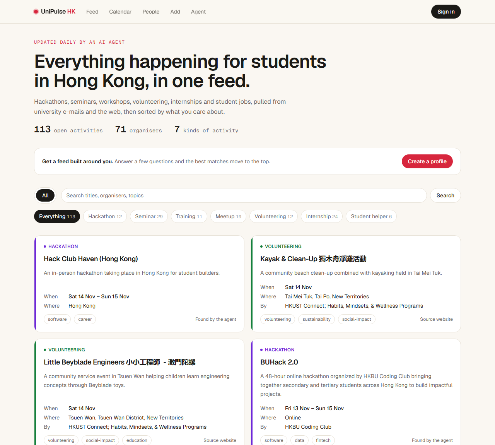
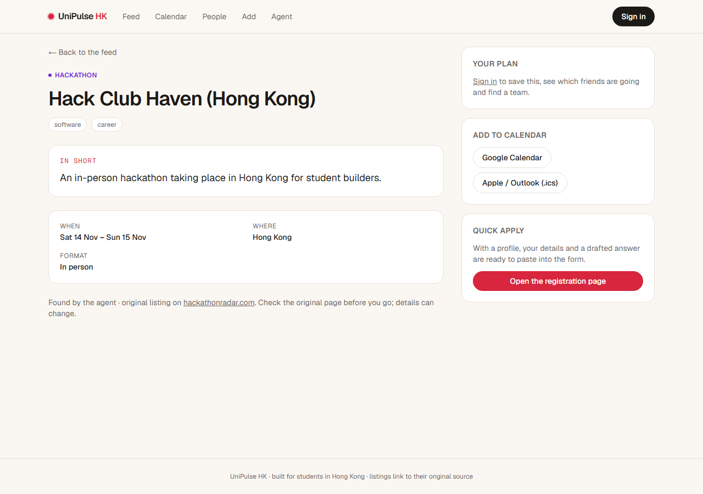
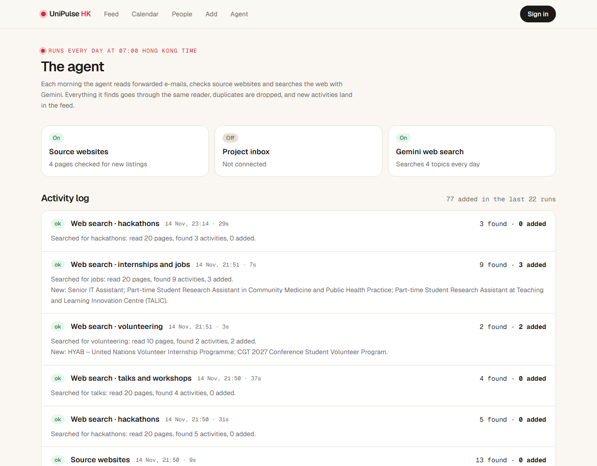

# UniPulse HK

**One feed of everything a university student in Hong Kong can take part in outside class**: hackathons, seminars, workshops, meetups, volunteering, internships and student helper jobs.

**Live demo: https://unipulse-hk.vercel.app** · Built for an ed-tech hackathon



## The problem

Invitations to these activities are scattered across university e-mail, department calendars and dozens of websites, so students miss them. Platforms like Devpost list the hackathons that organisers post there. They do not find the seminar that landed in your inbox, the volunteering programme on an NGO page, or the internship that closes next week.

## The idea

An agent does the searching, so students do not have to. Every morning it collects activities from several kinds of source, an AI model turns messy text into clean cards, duplicates are dropped, and the feed re-sorts itself around each student's interests. A new student answers four or five questions in a chat; from then on every card says *why it fits them*.

| | Devpost-style listings | UniPulse HK |
|---|---|---|
| Where data comes from | Organisers publish on the platform | An agent collects from e-mail, websites and web search |
| Kinds of activity | Hackathons | Hackathons, talks, training, meetups, volunteering, internships, student jobs |
| Scope | Worldwide | Hong Kong students |
| Personalisation | Filters | AI onboarding, ranking with a one-line reason |
| Applying | Per platform | Saved profile, drafted application answer, calendar export |

## Screenshots

| Event page | The agent and its log |
|---|---|
|  |  |

## Features

- **Daily agent.** Reads a project inbox of forwarded university e-mails, a list of source websites, and searches the web with Gemini (Google Search grounding). Everything goes through one extractor, duplicates are dropped, new activities land in the feed. The `/agent` page shows what it did and when.
- **AI onboarding.** A short chat with Gemini builds the student's profile (university, major, interests, skills, goals). A plain form does the same job when no AI key is set.
- **Personal feed.** Events are scored against the profile; Gemini re-ranks the best matches and writes a one-line "why this fits you".
- **Quick apply.** Profile details one tap from the clipboard, plus a motivation answer drafted from the student's own profile, next to the registration link.
- **Calendar.** Add any event to Google Calendar or download an `.ics` file; export everything you saved in one file.
- **People and teams.** Follow classmates to see what they are going to; start or join a team for a hackathon.
- **Add an activity.** Paste an invitation and Gemini turns it into a card, or fill in a form.

## Tech stack

Next.js 16 (App Router, TypeScript) · Tailwind CSS · Supabase (Postgres, auth, row level security) · Google Gemini (`@google/genai`) · Tavily search API · Vercel (hosting and daily cron) · Vitest.

## Run it locally

Requires Node.js 20 or newer.

```bash
npm install
cp .env.example .env.local   # then fill it in, see below
npm run dev
```

Open http://localhost:3000.

With an empty `.env.local` the site runs in **preview mode**: it shows the curated starter list read-only, with accounts and AI switched off. Each service you configure switches on more of the site.

### 1. Database and accounts (Supabase)

1. Create a free project at [supabase.com](https://supabase.com).
2. In **Project Settings → API**, copy the project URL, the `anon` (publishable) key and the `service_role` (secret) key into `.env.local`.
3. Open **SQL Editor**, paste the whole of [`supabase/schema.sql`](supabase/schema.sql) and run it.
4. For a demo, switch off **Authentication → Sign In / Providers → Email → Confirm email**, so new accounts can sign in at once.
5. Load the starter list: `npm run seed`.

### 2. AI features (Gemini API)

Put a key from [Google AI Studio](https://aistudio.google.com/apikey) into `GEMINI_API_KEY`. This switches on the onboarding chat, reading of pasted invitations, "why this fits you", answer drafting, and the agent's web search and e-mail steps.

Set `GEMINI_MODEL` to use a different Gemini model than the default in `lib/ai/client.ts`. When the chosen model is overloaded the request moves on to the next one in the list. `npm run check-ai` runs every AI feature once against the real model.

The agent's open web search uses [Tavily](https://tavily.com) when `TAVILY_API_KEY` is set (free tier: 1,000 credits a month, no card; a daily run uses about 200 a month) and otherwise falls back to Gemini's Google Search grounding, which needs a Gemini plan with search quota. Tavily finds the pages, Gemini turns them into cards, and a card is kept only if its link was returned by the search or answers when opened. Everything else, including the agent reading the source websites below, works on a free Gemini key.

### 3. The agent

| Setting | What it switches on |
|---|---|
| `AGENT_ADMIN_EMAILS` | Accounts that see the **Run now** buttons on `/agent` |
| `CRON_SECRET` | Lets the scheduler call `/api/agent/run` |
| `SOURCE_URLS` | Extra pages that list activities, comma-separated (the defaults are in `lib/agent/config.ts`) |
| `IMAP_USER`, `IMAP_PASS` | The project inbox (a Gmail address and an app password) |

Run it from the terminal with `npm run agent`, one step with `npm run agent -- sources`, or one search topic with `npm run agent -- search jobs`.

## How it fits together

```
project inbox (IMAP) ────────┐
source websites (JSON-LD) ───┼─► extractEvents() ─► dedupe ─► events table ─► feed
Gemini + Google Search ──────┤     (Gemini, structured output)
pasted text / manual form ───┘

profile (AI onboarding) ─► tag score ─► Gemini re-rank + reason ─► "For you"
```

- `lib/ai/` – the Gemini calls: `extract.ts` (text to event cards), `onboarding.ts` (chat with a `save_profile` tool), `rank.ts` (re-ranking and answer drafting).
- `lib/agent/` – one file per source, plus `run.ts`, which records every run.
- `lib/events/` – deduplication, calendar files, schema.org parsing, input cleaning. No network, fully unit tested.
- `lib/rank/score.ts` – the tag-based fit score that works without any model call.
- `supabase/schema.sql` – tables, row level security and grants.

Pages that list events on a site with schema.org data are parsed without a model call. Text sources go through Gemini. Either way a card links back to the page it came from.

## Privacy

- Phone, student ID and links live in a separate table that only their owner can read, enforced by the database.
- A student's "saved" and "applied" lists are private; only "going" is visible to others.
- From forwarded e-mails the agent keeps the activity details and the subject line. It does not store the sender, the forwarding student or the rest of the message.
- Students cannot give themselves the Verified badge: it is set at sign-up from the e-mail domain, and the column is not writable by them.

## Checks

125 unit tests cover deduplication, calendar files, schema.org parsing, ranking, date handling and, on a real in-process Postgres, the database access rules.

```bash
npm test          # unit tests, including the database access rules on an in-process Postgres
npm run typecheck
npm run lint
npm run build
```

## Deploy

The project is set up for Vercel: import the repository, add the same variables as in `.env.local`, and deploy. `vercel.json` schedules the agent for 07:00 Hong Kong time every day; Vercel sends `CRON_SECRET` with each scheduled call.

## Known limits

- The free Gemini tier allows a limited number of requests per day, so AI features can answer "quota used up" late in the day; the app then falls back to a lighter model, and finally to plain forms.
- The project inbox (forwarding university e-mails) is implemented (IMAP reader plus the same extractor), but it has not been run end to end: it needs a Gmail address and an app password, and it is switched off in the demo.
- Some university sites block automated readers or publish no event data; the agent skips those and logs why.

Made by Aibar, Shyngys, Yerassyl, Yermukhamed

## Data

The starter list in `data/seed-events.json` was collected on 13 November 2026 from the HKUST events calendar, StartmeupHK, HKCERT, GS1 Hong Kong, Time Auction, Crossroads Foundation and the CUHK Career Planning and Development Centre. Every entry links to the page it came from. Where a source gave a date without a time, the event is stored as a whole-day entry; deadlines given as a date run to the end of that day.
